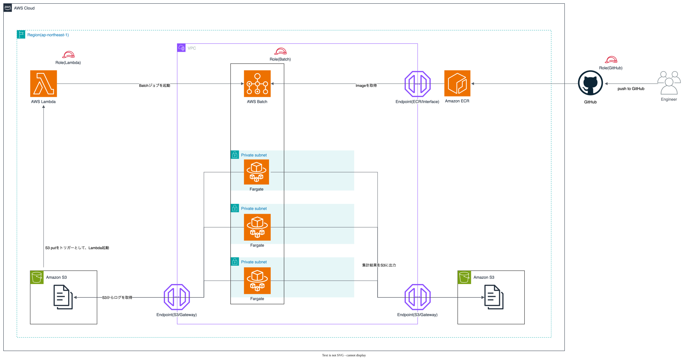

# aws-batch-fargate-terraform

[English](README.md) | 日本語

S3 に置いたアクセスログを AWS Batch (Fargate) で集計し、結果を別の S3 バケットへ出力するサーバレスバッチを Terraform で構築するリポジトリです。

Qiita のハンズオン記事「[【30日でAWSをマスターするハンズオン問題集】Day12：AWS Batch（Fargate）でサーバレスなアクセスログの集計バッチを作成してみよう](https://qiita.com/pommny_dev/items/1391c80159be9149bc8a)」でマネジメントコンソールから手作業で作る構成を、Terraform のコードとして整備したものです。

> [!NOTE]
> 実際に AWS 上へデプロイして動作を確認したコードです。公開にあたり、AWS アカウント ID、IAM ロール名、S3 バケット名などの環境固有の値をマスキングし、変数や GitHub Secrets から渡す形に置き換えています。マスキング後の状態では再デプロイしていないため、利用する際は自分の環境の値を設定したうえで `terraform plan` の結果を確認してください。

## 構成



処理の流れは次のとおりです。

1. GitHub Actions が集計スクリプトの Docker イメージをビルドし、ECR へ push する
2. アクセスログ (CSV) をソース用 S3 バケットへアップロードする
3. S3 のイベント通知 (`s3:ObjectCreated:Put`) が Lambda を起動する
4. Lambda が AWS Batch にジョブを送信する
5. Batch (Fargate) のジョブがログを集計する
6. 集計結果 (CSV) を結果用 S3 バケットへ出力する

S3 のイベント通知から Batch を直接起動できないため、Lambda を経由しています。

## ディレクトリ構成

```
.
├── main.tf                    # 各モジュールの呼び出し
├── provider.tf                # AWS プロバイダ設定
├── backend.tf                 # tfstate 用バケットと S3 バックエンド設定
├── variables.tf               # 変数定義 (バケット名、名前・タグ用の値)
├── terraform.tfvars.example   # 変数ファイルの雛形
├── modules/
│   ├── network/               # VPC、プライベートサブネット、VPC エンドポイント (S3 / ECR)、セキュリティグループ
│   ├── iam/                   # Batch 実行ロール、Batch タスクロール、Lambda 実行ロール
│   ├── s3/                    # ソース用・結果用バケット、イベント通知
│   ├── ecr/                   # ECR リポジトリ
│   ├── lambda/                # Batch ジョブを送信する Lambda 関数
│   └── batch/                 # コンピューティング環境、ジョブキュー、ジョブ定義
├── Dockerfile                 # 集計バッチのコンテナイメージ
├── aggregate_accesslog.py     # 集計スクリプト
├── accesslog_20240321.csv     # 動作確認用のサンプルログ
├── diagram.drawio             # 構成図のソース (draw.io)
└── .github/workflows/         # CI (terraform plan、ECR への push、PR 自動作成)
```

## 前提

- Terraform 1.14 系 (CI では 1.14.6 を使用)
- AWS プロバイダ 6.21.0
- リージョンは `ap-northeast-1` 固定
- AWS の認証情報が設定済みであること
- GitHub Actions を使う場合は、GitHub 用の OIDC ID プロバイダと IAM ロールを別途作成しておくこと (このリポジトリの Terraform では作成しません)

## 使い方

### 1. 変数ファイルを用意する

```sh
cp terraform.tfvars.example terraform.tfvars
```

`terraform.tfvars` のバケット名を自分の環境用に書き換えます。S3 バケット名は全世界で一意である必要があります。`terraform.tfvars` は `.gitignore` の対象です。

| 変数 | 内容 |
|---|---|
| `source_bucket_name` | アクセスログを配置するバケット名 |
| `result_bucket_name` | 集計結果を出力するバケット名 |
| `tfstate_bucket_name` | tfstate を保存するバケット名 |

次の変数は任意です。リソース名とタグに使われます。

| 変数 | 既定値 | 内容 |
|---|---|---|
| `environment` | `dev` | 環境名。リソース名の接頭辞と `Name` / `Environment` タグに使われる |
| `vpc_name` | `fargate-batch-vpc` | VPC の名前。ネットワーク系リソースの `Name` タグに使われる |
| `ecr_repo_name` | `fargate-batch-repo` | ECR リポジトリ名。変更する場合は `ecr_push.yaml` の `ECR_REPOSITORY` も合わせる |
| `github_repo` | `hot377/aws-batch-fargate-terraform` | GitHub リポジトリ名 (`owner/repo` 形式) |

### 2. リソースを作成する

```sh
terraform init
terraform plan
terraform apply
```

tfstate を S3 で管理する場合は、初回の `apply` で tfstate 用バケットを作成したあと、`backend.tf` 冒頭のコメントアウトを外して `bucket` を自分のバケット名に書き換え、もう一度 `terraform init` を実行します。

### 3. コンテナイメージを push する

`main` ブランチで `Dockerfile` または `*.py` を変更して push すると、GitHub Actions (`ecr_push.yaml`) がイメージをビルドして ECR へ push します。

### 4. 動作確認

ソース用バケットへアクセスログをアップロードします。

```sh
aws s3 cp accesslog_20240321.csv s3://<source_bucket_name>/
```

Batch のジョブが完了すると、結果用バケットに `YYYYMMDD/summary_YYYYMMDD.csv` が出力されます。

## 入出力の形式

### 入力

- ファイル名: `accesslog_YYYYMMDD.csv`
- 列: `timestamp,ip,status` (集計に使うのは 1 列目と 3 列目)
- 1 列目が `timestamp` で始まる行はヘッダーとして読み飛ばします

```csv
timestamp,ip,status
2026-03-21 00:01:23,192.168.1.1,200
2026-03-21 00:03:47,10.0.0.5,404
```

### 出力

| metric | 内容 |
|---|---|
| `period_start` | ログ内で最も早いタイムスタンプ |
| `period_end` | ログ内で最も遅いタイムスタンプ |
| `total` | 集計対象の行数 |
| `status_200` | ステータスコードが 200 の行数 |
| `status_other` | ステータスコードが 200 以外の行数 |
| `skipped_rows` | 形式不正で読み飛ばした行数 |

## GitHub Actions

| ワークフロー | トリガー | 内容 |
|---|---|---|
| `plan.yml` | `main` への Pull Request | `terraform fmt` / `init` / `validate` / `plan` を実行し、結果を PR にコメントする |
| `ecr_push.yaml` | `main` への push (`Dockerfile`、`*.py` の変更時) | イメージをビルドして ECR へ push する |
| `auto-pr.yml` | `develop` への push | `main` 向けの Pull Request を自動作成する |

利用するには、リポジトリに次のシークレットを登録します。

| シークレット | 内容 |
|---|---|
| `AWS_ROLE_ARN` | GitHub Actions が OIDC で引き受ける IAM ロールの ARN |
| `SOURCE_BUCKET_NAME` | `source_bucket_name` の値 |
| `RESULT_BUCKET_NAME` | `result_bucket_name` の値 |
| `TFSTATE_BUCKET_NAME` | `tfstate_bucket_name` の値 |
| `MY_PAT` | PR 自動作成に使う Personal Access Token |

## 片付け

```sh
terraform destroy
```

ソース用・結果用バケットにオブジェクトが残っている場合と、ECR リポジトリにイメージが残っている場合は削除に失敗するため、先に中身を空にしてください。

## ライセンス

このリポジトリの Terraform コード、GitHub Actions のワークフロー、ドキュメント、構成図は [MIT License](LICENSE) で公開しています。

アプリケーションコード (`aggregate_accesslog.py`、`Dockerfile`、`modules/lambda/src/function.py`) は下記の Qiita 記事で公開されているコードに基づくもので、このリポジトリの MIT License の対象外です。利用条件は元の記事を参照してください。

## 参考

- [【30日でAWSをマスターするハンズオン問題集】Day12：AWS Batch（Fargate）でサーバレスなアクセスログの集計バッチを作成してみよう](https://qiita.com/pommny_dev/items/1391c80159be9149bc8a)
